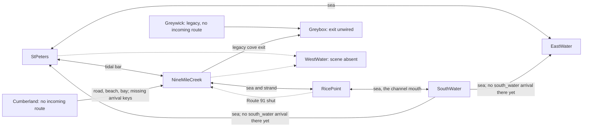

# Region seam audit and connection proposal

Audited base: `51d30dca25fa836696be476b8b134b9ff990a9bd`.
This is an audit and a proposed connection plan, **not connected gameplay**.
No scene, prefab, asset, input, HUD, price, or save format is changed.

## What exists

The six requested scenes are all enabled in `EditorBuildSettings.asset`.
They are not all reachable. Starting at St Peters, the structural passage graph
reaches St Peters, East Water, Nine Mile Creek, Rice Point, the South Water
(through Rice Point's channel mouth) and the external Greybox/Coddle Cove scene. It does not reach Cumberland or Greywick. Greybox is a
dead end. Two existing exits target a missing West Water scene.

This statement is a **structural route result**, conditional on earning a boat
and physically reaching the relevant trigger at a suitable tide. It is not a
claim of a fresh end-to-end playthrough. No developer scene selection is counted
as normal-game reachability.

Reused rather than replaced:

- `World/RegionDef`: existing stable region IDs, scene names and tide settings.
- `World/RegionPassage` and `RegionSceneLoader`: explicit target references,
  consume-once arrival key, additive loading and re-entry guards.
- `App/RegionAnchor` and `RegionTravelCoordinator`: named boat/foot arrivals,
  dock binding and preserved control mode. A previously recorded authored berth
  can override a boat's named arrival; direct-Play behavior is not a fresh visit.
- `Core/IRegionPassageAccess` and `App/LandPassageAccess`: existing on-foot guard.
- Existing `LandScenePlanDef`/`LandDoor` data for Rice Point and Cumberland:
  `TargetArrival`, `OwnArrival`, `Size`, `Arrival`, `Disembark`, `OnFootOnly`, `Shut`.
  These already carry the authorable values; no competing Def type is added.
- `StPetersLayerRefresh.SceneYaml`: the existing Force Text reader, used read-only
  by the new tests. No updater, builder, import, bake or scene-save API is called.
- Existing West Water plan/builder, arrival, Rice Point crossing and region tests.
  Their existence is useful context, not a claim that they ran in this audit.

`RegionSeamGraph` is a new pure inspection utility over immutable snapshots of
those facts. It has no callers outside the new test fixture, no content IDs or
coordinates hard-coded into production, no registration and no runtime wiring.
It sorts output ordinally; seed/time cannot affect a static authored graph.
Terrain/tide evaluation remains with existing services. No new tunables are needed.

## Current graph

Solid arrows below mean enabled, built-target structural routes; dashed arrows
show a missing target or a deliberately shut road. Separate rows in the inventory
distinguish parallel sea and foot routes.

There are 16 passage components in the requested six scenes, plus Greybox's
unwired exit: 17 audited records. The South Water adds three more (see
"The South Water's north seams" below) and Rice Point's channel mouth one: 21. Referenced prefabs (5 distinct sources since the Nine Mile Creek fuel stop retired the old forecourt's eight,
including recursive discovery) contain no additional passage, anchor or loader.
The opening is a separate scripted hop: the built first scene is St Peters;
its `ArrivalOpening` reads `ArrivalSea.asset`, hops to East Water at `opening`,
then returns through the East Water passage using St Peters' `east_water` key.
The existing story/rest conditions decide whether the opening plays.

## Every sea, shore and road transfer

Scene paths below are `Assets/_Project/Scenes/<name>.unity`; the line is the
passage component header in the audited base. Positions are unsquashed world XY
metres in the source's own frame. “Foot” identifies the intended route; bar
passages currently have **no** `LandPassageAccess` component. “Road” today also
means on foot: driving is refused, and no truck is transferred.

| Source / line / passage | Medium; band centre / size | Destination; requested arrival | Matching return and result |
| --- | --- | --- | --- |
| EastWater:567 `PassageToStPeters` | Sea; (-356,0) / 6×520 | StPeters; `east_water` | Yes, StPeters east door. Named boat point (316,40); no named foot point, so default landing applies. |
| Greywick:2006 `PassageToCoddleCove` | Sea, unguarded; (14,0) / 3×16 | Greybox; default | **No working return.** Greybox target is null. Reaches the cove only when Greywick was opened directly. |
| NineMileCreek:47505 `PassageToWestWater` | Sea; (356,38) / 6×120 | WestWater; `nine_mile_creek` | **Unavailable:** Def exists, scene and build entry do not. Loader declines the travel. |
| NineMileCreek:179075 `PassageToStPeters` | Bar, unguarded; (352,-200) / 6×120 | StPeters; `bar` | Yes. Foot point (-344,0); tide-gated terrain, not a passage-level tide check. |
| NineMileCreek:303043 `PassageToCoddleCove` | Sea, unguarded; (370,60) / 6×40 | Greybox; default | **One-way dead end:** default arrival references exist, but Greybox's outgoing target is null. |
| NineMileCreek:402105 `PassageToRicePointSea` | Sea; (-377,-262.5) / 6×35 | RicePoint; `nmc_sea` | Yes. Boat (366,-162.5); foot fallback (366,-90). Shallow-hull/tide limits below. |
| NineMileCreek:402202 `PassageToRicePointStrand` | Foot only; (-377,-196) / 6×8 | RicePoint; `nmc_strand` | Yes. Foot (366,-96); exposed-strand arrival, not all-tide dry. |
| StPeters:68964 `PassageToNineMileCreek` | Bar, unguarded; (-356,0) / 6×120 | NineMileCreek; `bar` | Yes. Foot (338,-197.7); ground about +0.871 m, so tide conditional. |
| StPeters:101637 `PassageToWestWater` | Sea; (-356,150) / 6×120 | WestWater; `st_peters` | **Unavailable:** no destination scene/build entry. |
| StPeters:130307 `PassageToEastWater` | Sea; (356,40) / 6×120 | EastWater; `st_peters` | Yes. Boat (-316,0); East Water has no foot landing. Requires arriving aboard. |
| RicePoint:1118 `door.rpt_sea` | Sea; (377,-162.5) / 6×35 | NineMileCreek; `rpt_sea` | Yes. Boat (-366,-262.5); foot fallback (-366,-190). |
| RicePoint:12690 `door.rpt_route_91` | Road, foot only; (377,-42) / 6×5.8 | NineMileCreek; `rpt_route_91` | **Shut:** collider disabled; NMC has neither the reciprocal road band nor this key. If invoked directly it would fall back to the wharf, so it must remain shut. |
| RicePoint:13311 `door.rpt_strand` | Foot only; (377,-96) / 6×8 | NineMileCreek; `rpt_strand` | Yes. Foot (-366,-196), exposed-strand arrival. |
| Cumberland:11582 `door.cmb_route_91` | Road, foot only; (-186,-277) / 5.8×6 | NineMileCreek; `cmb_route_91` | **One-way/incomplete:** no NMC return band or named arrival; loader falls back to the wharf. |
| Cumberland:13358 `door.cmb_north_beach` | Foot only; (67,-277) / 8×6 | NineMileCreek; `cmb_north_beach` | **One-way/incomplete:** same missing return/key; beach also needs low tide. |
| Cumberland:14134 `door.cmb_bay` | Sea; (260.5,-277) / 239×6 | NineMileCreek; `cmb_bay` | **One-way/incomplete:** same missing return/key; a successful load is not a matched seam arrival. |
| Greybox:322 `PassageToPortGreywick` | Sea, unguarded; (-22,-12) / 3×28 | **Null target** | Cannot activate. The name is stale evidence, not a RegionDef reference to Greywick. |

No other sea or road passage is serialized in these scenes or their referenced
prefabs. Cumberland's north Route 91 continuation near (-213,280) and east road
end at (380,18) are **closed geography**, not transfer edges; their onward regions
are not authored. East Water and Greywick have no road doors.

## The South Water's north seams

The South Water (`region.south_water`, 2400 × 1200 m, north edge y = 600) holds **its own
halves only**: three sea doors on its north edge and the three named arrivals the neighbours'
exits ask for. Its doors send the key `south_water`. **Rice Point has opened its half** (the
channel mouth, below), so one route leads INTO the South Water and its Rice Point door is paired.
St Peters and the East Water have not: the two doors to them are still reported under missing
named arrivals and unpaired edges, and a boat sent north through either would land at that
neighbour's default arrival.

| South Water door | Centre | Band (w × d) | Sends key | Arrival here | Arrival key here | Bed at door |
| --- | --- | --- | --- | --- | --- | --- |
| `PassageToRicePoint` | (-900, 576) | 260 × 6 | `south_water` | (-900, 536) | `rice_point` | −7 m, Rice Point's trawler channel |
| `PassageToStPeters` | (250, 576) | 260 × 6 | `south_water` | (250, 536) | `st_peters` | −4 m, St Peters' harbour floor |
| `PassageToEastWater` | (950, 576) | 260 × 6 | `south_water` | (950, 536) | `east_water` | −4 m, the East Water's floor |

Every door is inset 24 m from the edge and every arrival stands 40 m inside its door, in
15.6 m of water or more at mean tide. The default arrival is the St Peters one.

**What each neighbour needs (their lanes, their builders; each in its own scene coordinates):**

| Neighbour | Exit band centre | Band (w × d) | Sends key | Named arrival to add | Arrival point | Notes |
| --- | --- | --- | --- | --- | --- | --- |
| Rice Point (760 × 360, south edge y = −180) | (-45, -156) | 14 × 6 | `rice_point` | `south_water` | (-46, -146) | **Built**: `door.rpt_south_water` in `RicePointPlan.asset`. In the dredged channel (flat bed −7 m from x −59 to −31 at the door), inset 24 m from the south edge. The arrival is on the channel's centre line 10 m inside the door, not 40 m: the 40 m point (-45, -116) lies on the outside trawler berth, so it was withdrawn. The channel runs at −7 m from y −180 up through the basin. On foot (a walker cannot come this way) the key falls to the wharf, (-56, -108.4). |
| St Peters (760 × 520, south edge y = −260) | (x, -236) | up to 260 × 6 | `st_peters` | `south_water` | (x, -196) | x is St Peters' choice anywhere its south water is at the harbour floor (−4 m) from the edge to the arrival. |
| East Water (760 × 520, south edge y = −260) | (0, -236) | up to 260 × 6 | `east_water` | `south_water` | (0, -196) | The whole bed is −4 m, so any x clear of the west door serves; the mid-line is proposed. |

A band on a south edge lies along x; the shared water builder's default band is an east or
west wall, so each neighbour states its band size.

## Reachability from a normal start

| Region | Result at this base | Path / limitation |
| --- | --- | --- |
| StPeters | Yes, start/home | First enabled build scene; scripted opening returns here. |
| EastWater | Yes, structurally | Scripted opening and StPeters sea passage; a later independent visit requires a usable boat. |
| NineMileCreek | Yes, tide conditional | Walk the bar from StPeters at low water. Earning/repairing the dory remains the existing progression. |
| RicePoint | Yes, tide/hull conditional | NMC strand on foot or sea door aboard; from the South Water by the channel mouth. Route 91 contributes no route yet. |
| Cumberland | **No** | All three authored edges are outgoing; no reachable scene targets Cumberland. Direct Play/scene selection does not count. |
| Greywick | **No, legacy** | No incoming target and no RegionDef naming its scene. Its anchor still says `region.port_greywick`, which `SaveMigration` migrates to `region.nine_mile_creek`. |
| Greybox / Coddle Cove, external | Yes, but a trap | NMC's legacy cove edge enters it; no working outgoing edge. |
| SouthWater | Yes, aboard | Rice Point's channel mouth (`door.rpt_south_water`), 7 m deep at every tide. St Peters and the East Water have no exit to it yet. |
| WestWater, external | **No** | Both scenes and older design text reference it, but this base has only its Def/builder/plan, not the scene file. Build registration cannot substitute for a scene asset. |

All seven existing top-level RegionDefs have blank unlock flags. The passage's
direct `Travel(RegionDef)` route does not depend on registry membership; simply
adding a destination to a loader's `_regions` list does **not** create an entrance
or repair an arrival. Rice Point and Cumberland retain inactive DEV CORE loaders
as well as their live loaders; the actual passage references resolve to the live
ones. Opening either region directly is not proof of travel from St Peters.

## Arrival safety: what is proved, conditional, or missing

The 29 non-null authored arrival-transform references exist and have pinned
world coordinates. Every centre is outside every enabled passage box in its
own scene. This rules out a point placed inside the trigger at rest; it does
**not** prove full-hull clearance, terrain support, obstacle clearance, navigation
through the approach, or safety at every tide. Named foot points are null by
design for some sea arrivals; named boat points are null for walking arrivals.
The anchor's normal fallback rules still apply.

Read-only numeric probes of the current NMC, Rice Point and Cumberland height
PNGs used their map's range/extent, the bottom-up Unity sample convention and
`PaintedHeightField`'s texel-centred bilinear mapping. Results below are approximate
source-data measurements, not Unity-import/physics or visual proofs. No image was
edited, rendered for acceptance, rebaked, or re-baselined.

| Destination point | XY | Nearest enabled band gap (m) | Ground / safety assessment |
| --- | --- | ---: | --- |
| NMC default boat / foot | (86.2,83.1) / (86.2,87.35) | 266.8 / 266.8 | About -4.336 / +3.421 m. Valid references, dry foot centre above the authored +2.2 m spring envelope. Full berth/hull support still belongs to existing berth tests. |
| NMC `bar` foot | (338,-197.7) | 11 | +0.871 m: low-water landing, not an all-tide route. |
| NMC `rpt_sea` boat / foot | (-366,-262.5) / (-366,-190) | 8 / 8.246 | -2.904 / +1.533 m. Sea centre has about 0.704 m water at -2.2 m spring low; foot fallback is not dry at spring high. |
| NMC `rpt_strand` foot | (-366,-196) | 8 | +0.757 m: tide conditional. |
| Rice Point default boat / foot | (-53.285,-109.825) / (-56,-108.4) | 427.398 / 430.082 | -2 / +3.400 m. The direct-Play boat centre is not afloat at the lowest spring water; do not infer all-tide safety from its default berth. |
| Rice Point `nmc_sea` boat / foot | (366,-162.5) / (366,-90) | 8 / 8.246 | -2.856 / +1.697 m. About 0.656 m water at spring low; foot fallback can flood at spring high. |
| Rice Point `nmc_strand` foot | (366,-96) | 8 | +0.944 m: tide conditional. |
| Rice Point `nmc_route_91` foot | (366,-42) | 50.636 while road shut | +5.849 m: dry centre, but no enabled paired road. With a matching road band the own-side gap would be 8 m. |
| Cumberland default boat / foot | (210.25,-128.25) / (210.25,-125.25) | 145.75 / 148.75 | -6 / +3.400 m: deep water/dry centre; no incoming route. |
| Cumberland `nmc_route_91` foot | (-186,-266) | 8 | +6 m: dry centre; no NMC return or key yet. |
| Cumberland `nmc_north_beach` foot | (67,-266) | 8 | -1.050 m: needs a genuinely low tide, not merely below datum. |
| Cumberland `nmc_bay` boat / foot | (240,-266) / (45.25,-266) | 8 / 19.470 | -6 / +3.894 m: deep/dry centres; NMC counterpart missing. |
| East Water default / `st_peters` boat | (-316,0) | 37 | Serialized `RectTidalTerrain` is uniformly -4 m. No foot landing is authored. |
| East Water `opening` boat | (-220,0) | 133 | Same -4 m floor; cinematic transfer has additional state beyond the ordinary passage. |
| St Peters default boat / foot | (213,-0.266548) / (211,3.633452) | 140 / 142 | References and centre clearance proved; scene-authored berth capture/standable surfaces can override the effective pose. No new full-berth or ground proof. |
| St Peters `east_water` boat | (316,40) | 37 | Matching keyed point; approach/full hull not exercised here. |
| St Peters `bar` foot | (-344,0) | 9 | Serialized analytic bar crest is +0.88 m at the ridge; low-tide route. Crossing the whole gut still needs the existing tidal-walk proof. |
| Greywick default boat / foot | (7,0) / (2,0) | 5.5 / 10.5 | Legacy rectangular terrain/landing; no normal inbound route and no new full-hull acceptance. |
| Greybox default boat / foot | (-2.5,-13.5) / (0,-10.5) | 18 / 20.5 | Arrival references exist; its unwired exit makes normal entry a dead end regardless of centre clearance. |

For comparison, current hull data gives dory draught 0.3 m, punt 0.5 m and Cape
Islander 1.4 m. The Rice Point sea-centre measurements therefore do **not** imply
Cape clearance at spring low. This audit changes neither draught nor terrain.
Actual usable depth must include the whole hull, water level, still water where
applicable, and grounding clearance; endpoint arithmetic is a lower-level check.

Missing Cumberland/Rice Point road keys are not rejected by the runtime:
`RegionAnchor.ArrivalPointFor/DisembarkPointFor` fall back, and the coordinator
places the player at NMC's default wharf. That can be a dry location and still be
the **wrong end of the journey**. The pure graph deliberately reports missing
keys separately from reachability so it does not hide this behavior.

## Proposed data work, in dependency order — do not apply from this audit

1. **Close the cove dead end before expanding the network.** Propose a Coddle Cove
   return to the existing NMC RegionDef, with NMC's intentional default wharf
   arrival and a genuine cove departure band. The present null-target passage
   and its stale name must be reconciled by the scene-owning lane. An alternative
   is to keep NMC's cove entry closed until that return is accepted. Do not use
   a renamed string or a registry row as a substitute for a paired passage.

2. **Add NMC's Cumberland halves and exact destination keys together.** Reuse the
   existing `LandDoor` contract and the established frame relation
   `NMC = Cumberland + (0,560)`. Candidates below mirror existing band dimensions
   and 11 m centre inset; they are proposed authoring data, not new tunables in code.

   | Proposed NMC outgoing band centre / size | Ask Cumberland for | New NMC return key | Candidate NMC return point |
   | --- | --- | --- | --- |
   | (-186,277) / 5.8×6; foot only | `nmc_route_91` | `cmb_route_91` | foot (-186,266), sampled +6 m |
   | (67,277) / 8×6; foot only | `nmc_north_beach` | `cmb_north_beach` | foot (67,266), sampled -1.153 m: tide conditional |
   | (260.5,277) / 239×6; sea | `nmc_bay` | `cmb_bay` | boat (240,266), sampled -6 m |

   The simple mirrored NMC **bay foot fallback** (45.25,266) samples only
   **+1.741 m**, below the +2.2 m spring envelope. **Do not accept that coordinate
   as an all-tide dry landing.** The scene owner must choose/prove a dry supported
   foot fallback using existing ground and walk reach, or explicitly constrain
   the route to aboard arrivals. No ground raising or coordinate retuning is
   made here. Add Cumberland to NMC's registry for ID-based travel/metadata, but
   prove the target references and arrival table independently.

3. **Finish Route 91 on foot after its NMC road authoring.** Existing Rice Point
   plan remains `Shut: 1` until NMC gains a (-377,-142), 6×5.8 band targeting
   `nmc_route_91`, and its `rpt_route_91` foot arrival at (-366,-142). That candidate
   samples +6 m on current NMC ground. Then change the existing plan's `Shut`
   through the owning scene workflow. Keep `LandPassageAccess`; vehicle transfer
   requires a separate W3 contract and is not part of these data edits.

4. **Restore the missing West Water asset through its owning art/scene lane.**
   Reuse `WestWaterPlan` and `WestWaterBuilder` rather than inventing another
   water graph. The existing builder authors `st_peters` and `nine_mile_creek`
   arrivals and **keyless** returns to the neighbours' default berths. Its
   deliberate default-return contract needs no invented `west_water` key in
   St Peters or NMC. A real scene, build entry, owned content/visual acceptance
   and two-way crossing tests are prerequisites; this audit runs no builder.

5. **Resolve Greywick's legacy identity before connecting it.** The scene is an
   archived port representation, not the new East Point region. Do not mint a
   second live `region.port_greywick`, undo migration, or rename NMC to make this
   graph green. If the aim is to inspect all six scenes, propose a separate
   **development-only, default-off** review connection from the cove to Greywick;
   its existing return goes to the cove, whose NMC return must first be fixed.
   That requires a non-conflicting inspection destination identity/loader
   contract, with no save migration change. It is not a normal-game connection
   proposal accepted by this audit. A permanent gameplay destination needs a
   canon/identity ruling and an art lane. The exact pending decision is whether
   Greywick remains an archive or receives an explicitly approved new purpose.

After steps 1–3, all canonical built destinations among the six can be reached
from St Peters, with the existing sea/strand alternatives retained. Step 4 repairs
the missing water route. A normal-game tour of **all six including Greywick**
cannot honestly be promised under the current canon and unchanged save identity;
step 5 is a documented dependency, not an automatic approval to expose it.

## Acceptance for a later connection change

Keep one entity per existing Def/plan and append-only stable IDs. Pair each
enabled band with the intended medium and named return; validate exact keys
before allowing an exit. Probe foot support and full hull/keel clearance across
the tide envelope in the real destination, and test fresh arrival separately
from revisits with a remembered berth. Confirm no re-entry bounce, correct
control mode, continuous carried inventory and no duplicated persistent core.
Goods remain physically carried; no seam design here licenses inventory teleport
between storages. Road walkers and vehicle transport remain distinct contracts.

The new guards pin today's **known incomplete graph**, not approval of its gaps.
When an owned connection lands, update the graph inventory and its design note
together; retain missing-key detection, unavailable-target rejection and closure
checks instead of deleting them to obtain green.

## Proof and limits

Thirty-eight new EditMode cases compiled and all 38 executed under .NET against
freshly compiled Core/World plus the existing Force Text reader. They assert:
seven scene edge inventories, seven named-arrival tables, seven coordinate
inventories (29 references), seven centre/trigger separation checks, four exact
reachability/gap sets, build/identity facts, opening content, recursive prefab
coverage, enumeration-order independence, fallback reporting, and disabled/missing
destination semantics. No test reads a save or writes a scene/asset.

No Unity editor lease was consumed. No local rendering, physics crossing, current
playtest, full-module green or imported-terrain certificate is claimed. The
numeric source probes narrow the next scene lane's work; they do not authorize
new artwork or a different terrain profile.
